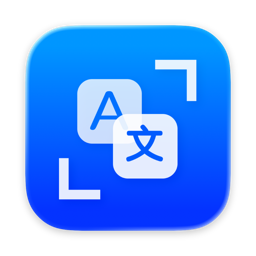
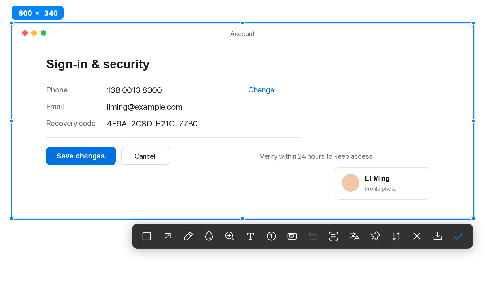
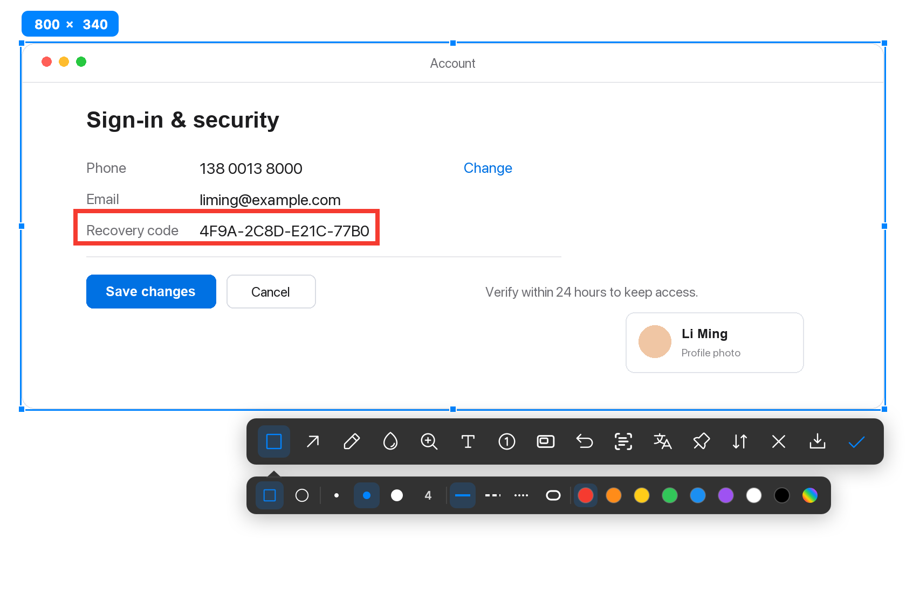
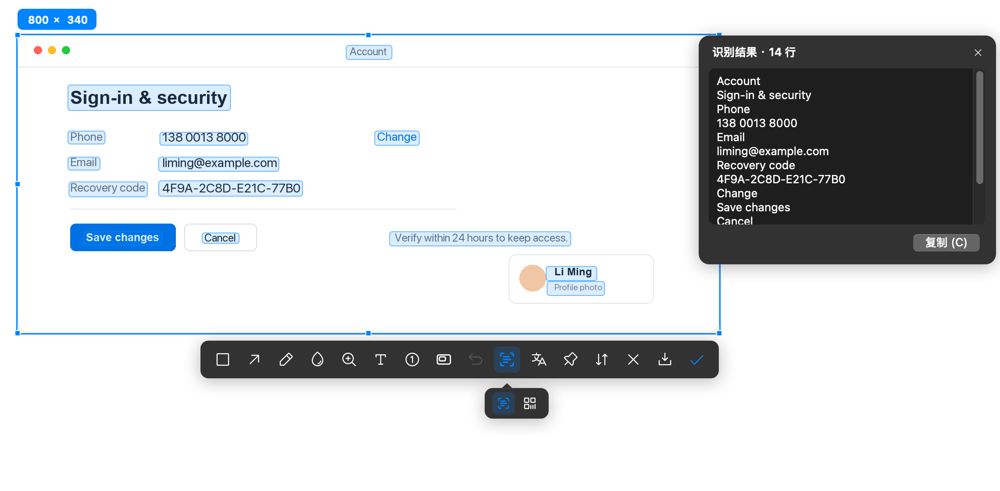
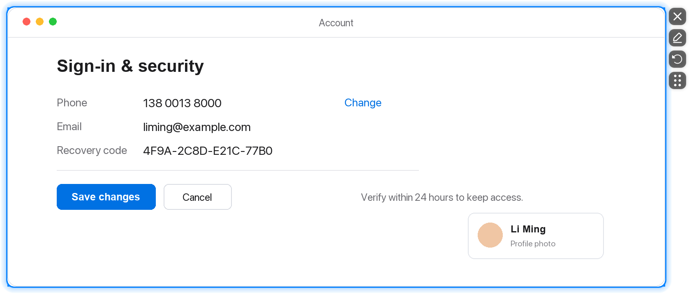
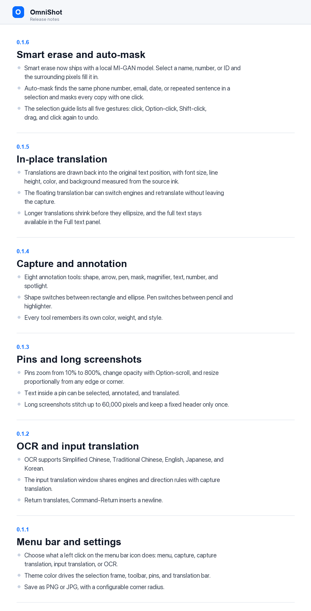

<p align="center">
  
</p>

<h1 align="center">OmniShot</h1>

<p align="center">截图、翻译、OCR，一个就够了。</p>

<p align="center">
  <a href="https://ivean.com/omnishot/">官网</a>
  ·
  <a href="https://www.ivean.com/omnishot/updates/OmniShot.dmg">下载 macOS 版</a>
</p>

---

OmniShot 是一个 macOS 菜单栏截图工具。框选之后，标注、文字识别、原位翻译、打码、贴图和长截图都在同一个界面里完成。

<p align="center">
  
</p>

## 一块选区，做完截图的事

选区一放下，所有工具都在这块选区上：形状、箭头、画笔、打码、放大镜、文字、序号和聚光灯。工具栏只有图标，鼠标停一下就会显示名称和按键。

<p align="center">
  
</p>

## 识别与翻译，留在原位

文字识别在本机完成，识别结果可以编辑、复制，也可以直接标在画面上。翻译会把译文画回原文的位置，字号、颜色和底色跟着原文走；中文屏幕自动译成英文，外文自动译成设置里的目标语言。

翻译引擎默认使用免费的腾讯交互翻译，也可以在设置里换成自己的 OpenAI 兼容大模型、Anthropic 或 Gemini。

<p align="center">
  
</p>

## 打码，不只是盖住

打码支持像素块、模糊和智能擦除。智能擦除用本地模型把内容补掉，而不是糊成一片。自动识别可以按号码、邮箱、日期、重复词句等类型一次选中相同内容，点一下全部打码，再点一次取消。

## 贴图

截图、标注和译文可以钉在屏幕最上层，支持缩放、旋转、文字选择和八边八角等比拉伸。截图时默认不会拍到自己的贴图。

<p align="center">
  
</p>

## 长截图

在选区里滚动页面，OmniShot 自动拼接成长图，最长 60,000 像素；也可以用自动滚动，让页面自己翻。

<p align="center">
  
</p>

## 常用快捷键

| 快捷键 | 功能 |
| --- | --- |
| `⌥A` | 截图 |
| `⌥⇧A` | 截图翻译 |
| `⌥⇧O` | 文字识别 |
| `⌥⇧T` | 输入翻译 |
| `⌥⇧V` | 从剪贴板贴图 |
| `⌥⇧H` | 隐藏 / 显示全部贴图 |
| `⌥⇧C` | 关闭全部贴图 |

快捷键都可以在设置里修改；`⌘Z`、`Esc`、`⌘S`、`↩` 固定不变。

## 系统要求

macOS 14 或更高。发布包是通用架构，Apple 芯片和 Intel 都能用。

## 隐私

- 文字识别和智能擦除都在本机完成，截图不会上传。
- 翻译只发送识别出的文字；API Key 只存在本机。
- 免费翻译使用公开接口，不需要 Key；也可以完全换成自己的大模型。

## 从源码构建

需要 macOS 14 或更高，以及 Xcode 或 Command Line Tools：

```bash
swift build
```

## 第三方许可

图标、MI-GAN 模型和 Sparkle 等第三方组件的许可与版权声明见 [THIRD-PARTY-NOTICES.md](THIRD-PARTY-NOTICES.md)。
